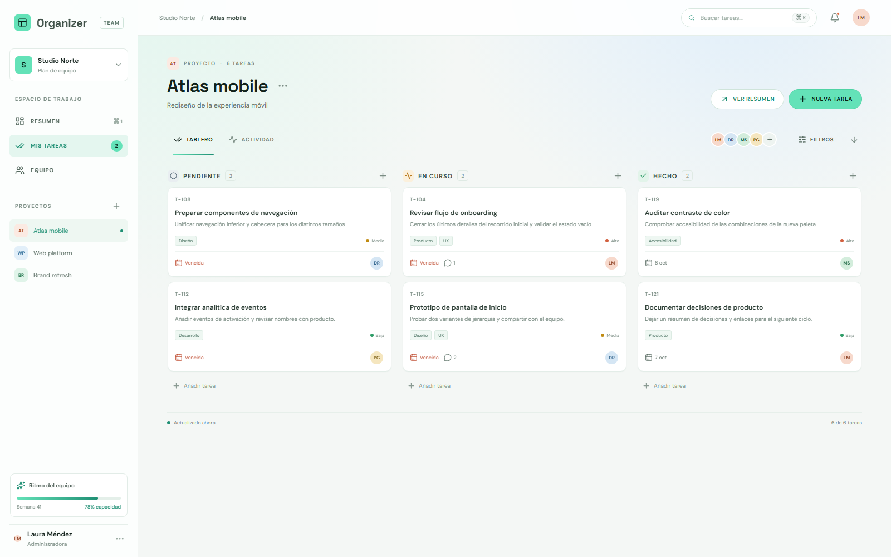
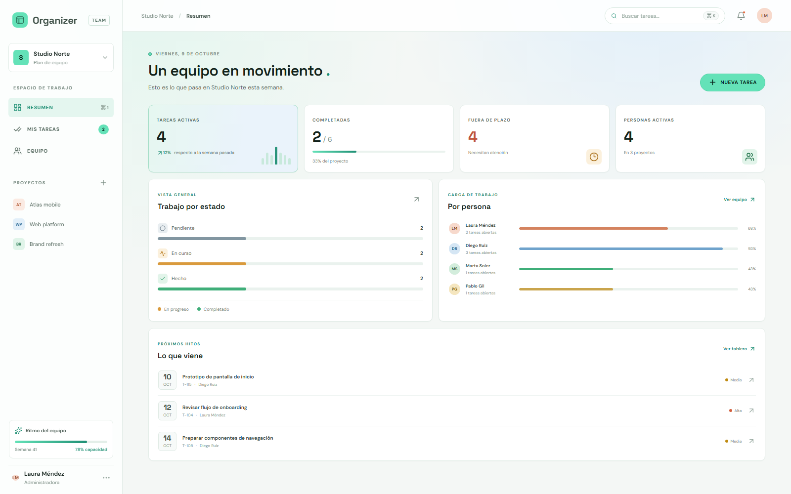
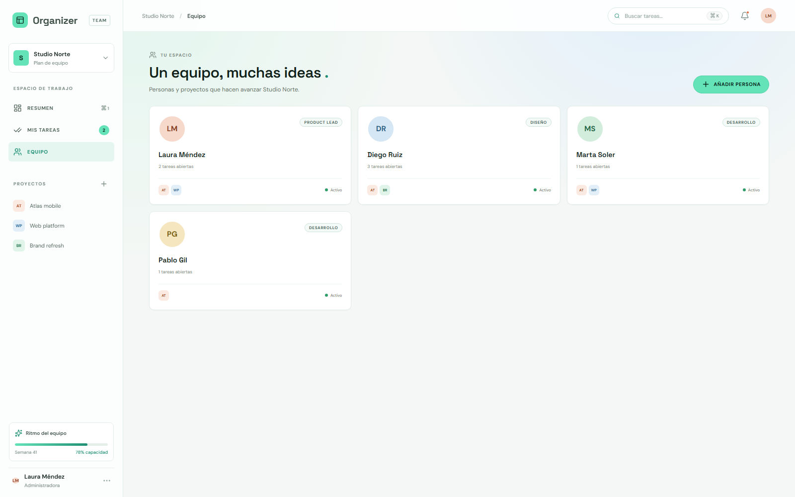

# Organizer

Organizer es un gestor de proyectos para equipos pequeños. Permite organizar proyectos en tableros Kanban, repartir tareas, seguir fechas, comentar el trabajo y revisar la carga del equipo.

La interfaz está hecha con Vue 3 y Vite. El API REST usa Laravel 12 y Sanctum. El entorno local usa MySQL; la demo pública gratuita usa SQLite temporal en Render. Docker ejecuta PHP 8.4, necesario para las dependencias actuales del backend.

## Capturas de la interfaz

Las capturas muestran la interfaz renovada de Organizer con datos ficticios del espacio de trabajo **Studio Norte**.

**Tablero Kanban** — tareas agrupadas por estado, con responsables, prioridades y fechas límite.



**Resumen del equipo** — métricas del proyecto, tareas por estado, carga de trabajo y próximos hitos.



**Equipo y proyectos** — miembros, tareas abiertas y proyectos compartidos en una vista de tarjetas.



Las imágenes no contienen datos de cuentas reales.

## Requisitos

- Docker Desktop iniciado, con el motor Linux habilitado.
- Node.js 22 o compatible con Vite 8 si se ejecuta el frontend fuera de Docker.
- Composer y PHP 8.4 solo si se ejecuta Laravel directamente en el host. El PHP 8.0 incluido en algunas instalaciones de XAMPP no es suficiente.

## Arranque paso a paso

1. Abre una terminal en la carpeta raíz del proyecto.
2. Inicia Docker Desktop y espera a que su motor indique que está listo.
3. Construye y levanta los tres servicios:

   ```bash
   docker compose up --build
   ```

4. Abre [http://localhost:5173](http://localhost:5173).
5. El primer uso abre el formulario de acceso. Selecciona **Regístrate** para crear una cuenta.
6. Completa nombre, correo y contraseña dos veces. La contraseña debe tener al menos 8 caracteres.
7. El primer registro de la base de datos obtiene el rol global `admin`. Organizer crea también **Mi primer proyecto** con código `ORG` y añade a esa cuenta como admin del proyecto.
8. Los registros posteriores obtienen el rol global `member`. Para que puedan entrar a un proyecto, una persona admin debe añadirlos desde la vista **Equipo** usando el correo con el que ya se registraron.

Compose inicia Vue en el puerto `5173`, Laravel/Apache en `8000` y MySQL en `3307` del host (`3306` dentro de Docker). Composer instala dependencias al construir la imagen; el entrypoint crea una `APP_KEY` temporal en modo local y aplica migraciones al arrancar.

Para detener los servicios, usa `docker compose down`. Los datos de MySQL están en el volumen `mysql_data` y se conservan. No añadas `-v` al comando si quieres conservarlos.

## Demo pública

- **Frontend:** [organizer-snowy.vercel.app](https://organizer-snowy.vercel.app/)
- **API:** [organizer-api-44v4.onrender.com](https://organizer-api-44v4.onrender.com/)
- **Health check:** [organizer-api-44v4.onrender.com/up](https://organizer-api-44v4.onrender.com/up)

Vercel publica la SPA desde la raíz del repositorio con `vercel.json`. Render construye el API con `api/Dockerfile`, usando `api` como directorio raíz.

### Configuración del API en Render

El servicio `organizer-api` usa el plan gratuito de Render y estas variables:

```text
APP_ENV=production
APP_DEBUG=false
APP_KEY=<clave-generada-para-esta-instalacion>
APP_URL=https://organizer-api-44v4.onrender.com
CORS_ALLOWED_ORIGINS=https://organizer-snowy.vercel.app
DB_CONNECTION=sqlite
DB_DATABASE=/tmp/organizer.sqlite
SESSION_DRIVER=file
CACHE_STORE=file
QUEUE_CONNECTION=sync
```

Genera una clave Laravel nueva localmente y configura el resultado en `APP_KEY`; no la subas a Git:

```bash
docker run --rm php:8.4-cli php -r "echo 'base64:'.base64_encode(random_bytes(32)).PHP_EOL;"
```

El endpoint `/up` sirve como comprobación de salud. El plan gratuito suspende el servicio tras periodos de inactividad, por lo que la primera petición puede tardar en despertarlo. La base SQLite está en el sistema de archivos temporal de Render: sus datos se pierden cuando el servicio se reinicia o se vuelve a desplegar. No uses esta demo para información importante.

### Configuración del frontend en Vercel

Importa el repositorio en Vercel con la raíz `.` y configura `VITE_API_BASE_URL` en Production:

```text
VITE_API_BASE_URL=https://organizer-api-44v4.onrender.com/api/v1
```

`vercel.json` configura `npm ci`, `npm run build`, `dist` y el fallback de la SPA. Si cambia el dominio de Vercel, actualiza `CORS_ALLOWED_ORIGINS` en Render para que coincida con el nuevo origen y vuelve a desplegar el API. En la demo pública, la primera cuenta registrada obtiene el rol admin y crea el proyecto inicial.

## Cómo se usa la web

### 1. Registro e inicio de sesión

- **Regístrate** crea una cuenta y envía el formulario a `POST /api/v1/auth/register`.
- **Iniciar sesión** valida correo y contraseña con Laravel en `POST /api/v1/auth/login`.
- Laravel entrega un token personal de Sanctum. El navegador lo guarda para autorizar las peticiones siguientes.
- **Cerrar sesión** revoca el token en el servidor y vuelve a mostrar el formulario de acceso.
- Al recargar, la web valida el token con `GET /api/v1/auth/me` y recupera proyectos, miembros y tareas.

El primer usuario de una base vacía es admin global; los siguientes son miembros. El rol global no sustituye al rol que una persona tiene en cada proyecto: las autorizaciones de proyecto se comprueban también contra su membresía.

### 2. Navegación y proyectos

La barra lateral contiene **Resumen**, **Mis tareas**, **Equipo** y la lista de proyectos a los que pertenece la cuenta.

- Selecciona un proyecto para cambiar su tablero.
- El botón `+` junto a **Proyectos** abre el formulario para indicar nombre, código corto y descripción. Solo una cuenta admin global puede crear proyectos. El código debe ser único y tener hasta 8 caracteres.
- Al crear un proyecto desde el API, quien lo crea queda vinculado como admin del proyecto.
- **Mis tareas** muestra el proyecto actual filtrado por la persona conectada y cuenta sus tareas abiertas.
- En móvil la navegación se abre con el botón de menú; el tablero puede desplazarse horizontalmente para recorrer sus columnas.

### 3. Tablero y estados

Cada proyecto tiene tres columnas:

| Columna en la web | Estado del API | Uso |
| --- | --- | --- |
| Pendiente | `todo` | Trabajo todavía no iniciado. |
| En curso | `in_progress` | Trabajo activo. |
| Hecho | `done` | Trabajo terminado. |

Pulsa **Nueva tarea** para abrir el formulario o `+` en una columna para crearla directamente con ese estado. También puedes abrir una tarea pulsando su tarjeta. Si el navegador permite arrastrar HTML5, las tarjetas se pueden soltar en otra columna; el cambio se envía al API y se conserva al recargar.

### 4. Crear y editar una tarea

En el formulario de tarea:

1. Escribe un título; es el único campo obligatorio.
2. Añade una descripción para el contexto y los criterios de trabajo.
3. Elige estado y prioridad: alta, media o baja.
4. Selecciona responsable y fecha límite. La fecha se puede dejar vacía desde la API.
5. Pulsa **Guardar tarea**. Una tarea nueva se asocia al proyecto seleccionado; una existente actualiza sus cambios.

Una persona admin del proyecto puede asignar la tarea a cualquier miembro de ese proyecto. Una persona miembro crea tareas asignadas a sí misma y solo puede editar tareas que tenga asignadas. Solo admin puede eliminar una tarea por API.

### 5. Comentarios

Abre una tarjeta, escribe en **Escribe un comentario...** y pulsa el icono de enviar. El comentario queda asociado a la tarea y muestra autor y hora.

Si la tarea todavía no se ha guardado, el comentario se añade al borrador y se envía junto con la tarea al guardar. En una tarea existente se crea de inmediato mediante `POST /api/v1/tasks/{task}/comments`.

### 6. Buscar y filtrar

El cuadro superior busca por título, descripción, identificador y etiquetas locales. En la barra del tablero:

- Pulsa un avatar para limitar los resultados a esa persona; vuelve a pulsarlo para quitar ese filtro.
- Abre **Filtros** para combinar estado, responsable y fecha.
- **Próximos 7 días** limita las tareas a esa ventana.
- **Vencidas** muestra tareas con fecha anterior a hoy que no están en estado Hecho.
- **Limpiar filtros** restaura todos los resultados.

El API también acepta `status`, `assignee_id`, `due_from`, `due_to`, `overdue` y `search` en `GET /api/v1/projects/{project}/tasks` y pagina los resultados de 50 en 50.

### 7. Resumen

Pulsa **Resumen** o **Ver resumen** para abrir el panel del proyecto seleccionado. Muestra tareas activas, completadas, vencidas y personas activas; un gráfico de tareas por estado; estimación de carga abierta por persona y los próximos tres vencimientos.

El endpoint `GET /api/v1/dashboard` ofrece métricas de proyectos, estados, vencimientos y carga por responsable para clientes del API. La fecha editorial que aparece sobre el panel es texto de demostración, no un calendario de actividad.

### 8. Equipo y miembros

La vista **Equipo** muestra personas vinculadas a los proyectos, tareas abiertas y proyectos compartidos.

1. Una persona admin del proyecto pulsa **Añadir persona**.
2. Introduce el correo de alguien que ya se haya registrado.
3. Elige `Miembro` o `Admin` para esa membresía y confirma.
4. Esa persona ya podrá ver el proyecto al iniciar sesión o recargar Organizer.

La invitación no envía un correo: comprueba que la cuenta exista y la añade directamente. El endpoint es `POST /api/v1/projects/{project}/members`.

## Persistencia y modo demostración

Con el stack de Docker y `VITE_API_BASE_URL` configurado, los datos se guardan en MySQL. El token de acceso se guarda en `localStorage`; proyectos, tareas, asignaciones, fechas y comentarios se leen y escriben mediante Laravel.

Para ejecutar solo la interfaz:

```bash
npm ci
npm run dev
```

Sin `VITE_API_BASE_URL`, Organizer activa el modo demostración: muestra proyectos y tareas de ejemplo, simula el acceso y guarda los cambios en `localStorage` del navegador. Ese modo sirve para probar la interfaz, pero no crea cuentas reales ni sincroniza datos entre navegadores.

## API REST

Todas las rutas están bajo `/api/v1`. Salvo registro e inicio de sesión, requieren la cabecera `Authorization: Bearer <token>`.

| Método | Ruta | Descripción |
| --- | --- | --- |
| `POST` | `/auth/register` | Crea usuario; acepta `name`, `email`, `password`, `password_confirmation`. |
| `POST` | `/auth/login` | Inicia sesión; acepta `email` y `password`. |
| `GET` | `/auth/me` | Devuelve la cuenta autenticada. |
| `POST` | `/auth/logout` | Revoca el token actual. |
| `GET` | `/projects` | Lista proyectos y miembros de la cuenta. |
| `POST` | `/projects` | Crea un proyecto; requiere admin global. |
| `GET` | `/projects/{project}` | Devuelve proyecto y miembros; requiere membresía. |
| `POST` | `/projects/{project}/members` | Añade una cuenta existente por `email` o `user_id`; requiere admin del proyecto. |
| `GET` | `/projects/{project}/tasks` | Lista y filtra tareas del proyecto. |
| `POST` | `/projects/{project}/tasks` | Crea tarea dentro del proyecto. |
| `PATCH` | `/tasks/{task}` | Actualiza tarea; admin del proyecto o persona asignada. |
| `DELETE` | `/tasks/{task}` | Elimina tarea; admin del proyecto. |
| `POST` | `/tasks/{task}/comments` | Añade comentario a una tarea accesible. |
| `GET` | `/dashboard` | Devuelve métricas agregadas de los proyectos del usuario. |

Ejemplo de creación de tarea:

```json
{
  "title": "Preparar entrega",
  "description": "Revisar la versión para el siguiente ciclo.",
  "status": "in_progress",
  "priority": "high",
  "assignee_id": 12,
  "due_at": "2026-10-16"
}
```

El responsable debe pertenecer al proyecto. Los valores admitidos para estado son `todo`, `in_progress` y `done`; para prioridad, `low`, `medium` y `high`.

## Datos y permisos

- `users`: credenciales y rol global.
- `projects`: nombre, código, descripción y propietario.
- `project_user`: relación usuario-proyecto y rol `admin`/`member` dentro de ese proyecto.
- `tasks`: proyecto, creador, responsable, título, descripción, estado, prioridad y fecha límite.
- `task_comments`: texto, tarea y autor.

Laravel comprueba la membresía en las rutas de proyecto y tarea. Una cuenta ajena no puede consultar tareas de un proyecto; tampoco se puede asignar una tarea a alguien que no forme parte de ese proyecto.

## Alcance actual

- La pestaña **Actividad** lleva al panel Resumen; no es un registro cronológico de eventos.
- Los iconos de notificaciones, ordenación y opciones del proyecto son elementos de interfaz todavía sin acción asociada.
- La asignación de personas en la vista Equipo se limita a cuentas ya registradas; no hay envío de invitaciones por correo.
- Las métricas de capacidad y la fecha editorial del panel son datos visuales de demostración. La carga abierta por persona se calcula a partir de las tareas disponibles.

## Pruebas y comprobaciones

Compilar frontend:

```bash
npm run build
```

Ejecutar pruebas Laravel en SQLite en memoria, separado de la base MySQL de desarrollo:

```bash
docker compose exec -T -e DB_CONNECTION=sqlite -e DB_DATABASE=:memory: -e DB_URL= api php artisan test
```

GitHub Actions ejecuta el build de Vue y las pruebas del API con PHP 8.4.
